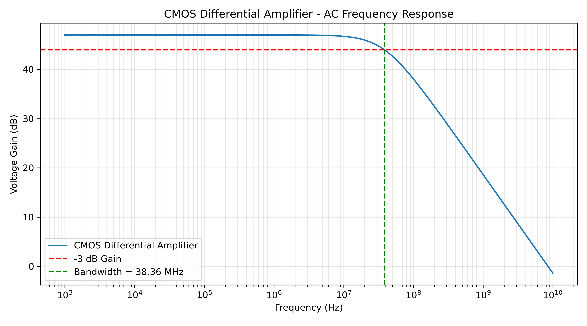

# CMOS Differential Amplifier — NGspice

## Overview

Designed and simulated a CMOS differential amplifier using NGspice and simplified LEVEL=1 MOSFET models.

The design integrates an NMOS differential input pair, PMOS current-mirror active load, ideal tail current source, and single-ended output.

Python automation was used to characterize gain, bandwidth, and power consumption across multiple bias-current operating points.

## Architecture

- **Supply voltage:** 1.8 V
- **NMOS differential pair:** M1 and M2
- **PMOS current-mirror load:** M3 and M4
- **Nominal tail bias current:** 100 µA
- **NMOS dimensions:** W = 10 µm, L = 0.18 µm
- **PMOS dimensions:** W = 20 µm, L = 0.18 µm
- **Output load capacitance:** 20 fF
- **Transistor models:** Simplified LEVEL=1 MOSFET

## Simulation Results

| Bias Current | Voltage Gain | -3 dB Bandwidth | Power |
|---|---|---|---|
| 25 µA | 52.982 dB | 9.607 MHz | 45 µW |
| 50 µA | 49.974 dB | 19.200 MHz | 90 µW |
| 100 µA | 46.966 dB | 38.361 MHz | 180 µW |
| 150 µA | 45.208 dB | 57.501 MHz | 270 µW |
| 200 µA | 43.960 dB | 76.615 MHz | 360 µW |

### AC Frequency Response

The frequency response was evaluated using NGspice AC analysis.

### Gain-Bandwidth-Power Tradeoff

Increasing the tail bias current from 25 µA to 200 µA resulted in:

- Bandwidth increasing from 9.607 MHz to 76.615 MHz
- Voltage gain decreasing from 52.982 dB to 43.960 dB
- Power consumption increasing from 45 µW to 360 µW

## Tools

- **NGspice** — transistor-level circuit simulation
- **Python** — automated bias-current sweep and data analysis
- **NumPy** — numerical calculations
- **Matplotlib** — frequency-response visualization

## Verification

- DC operating-point analysis
- Transistor biasing measurements
- AC gain and bandwidth analysis
- Supply power measurements
- Automated bias-current sweep
- Reproducibility verification across five operating points

## Project Files

- `diff_amp.cir` — main amplifier SPICE netlist
- `sweep_bias.py` — automated NGspice bias-current sweep
- `plot_gain.py` — frequency-response plotting script
- `results/bias_sweep.csv` — measured simulation results
- `results/gain_response.png` — AC frequency-response graph
- `results/gain_response.txt` — frequency-response data

## Conclusion

This project demonstrates transistor-level CMOS analog circuit design, frequency-domain analysis, automated simulation, and quantitative characterization of gain, bandwidth, and power tradeoffs.

